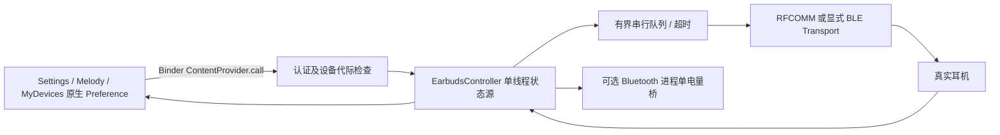

# 架构

`core` 为无 Android 依赖的 Java 17 协议与状态模块；`app` 是 Android 15 模块、受控服务和宿主 UI 适配。所有 APK 测试与编译在 Actions。

## Hook 与 UI

API `102.0.0` 的 `XposedModule.onPackageReady` 使用宿主 ClassLoader。仅 SDK 35 且 OnePlus/OPPO/realme 品牌进入候选路径；品牌门禁并不证明 ROM 必为 ColorOS，宿主仍需结构匹配。没有 system_server/SystemUI Hook，无旧 API。模块不修改原调用参数或吞掉宿主异常：先 `chain.proceed()`，再在独立 try/catch 中更新模块 UI。

HostInstaller 在选定包的 AndroidX Fragment `onResume/onPause/onDestroyView` 上安装有限生命周期 Hook，要求该对象暴露原生 PreferenceScreen，存在已知蓝牙/耳机 key，并能从本页面参数或 Activity extras 获取明确设备地址。不会用“最近设备”替代当前页面地址。暂停/销毁释放面板、监听线程和上下文。

NativePreferencePanel 反射实例化宿主 COUI 控件，缺失时使用宿主 AndroidX Preference；不将模块 AndroidX 类型强塞给宿主。反射签名不匹配则删除已插入区，保留原页面。每 2 秒在工作线程获取快照，主线程仅渲染；不扫描蓝牙、不在绘制中握手。切换控件立即返回 false，不永久乐观更新。当前只支持结构匹配的 Preference 页面；混淆过的方法、纯 ViewBinding 页面待宿主分析，不冒认支持。

## 设备与状态

用户在模块界面选择已配对设备并确认型号。DeviceRuntime 要求 exact normalized name + Edifier SDP UUID；已 `READY` 且协议已识别的地址可显式保存 Profile。改名后仍要求相同已配对地址与服务 UUID。名称、UUID、用户确认和协议数据不是密码学型号证明；无法辨别同槽位型号被人为伪装，不能冒称强身份认证。

Evo Pro 必须得到有效 F2 电量及 `0x1B` ANC 响应才 READY。不能只凭 D8 或品牌名开放写入。所有型号固定查询白名单，不做自动协议爆破或跨型号尝试。BLE 实现有真实 GATT discovery / CCCD / 单写在途逻辑，但未绑定 Evo Pro；其已证实通道仅 RFCOMM。无隐藏 RFCOMM channel 1 fallback。

连接 12 秒超时，单命令 5 秒超时，最多 1 个在途+8 个等待请求。队列超时污染整个会话并关闭 socket，拒绝晚到同 opcode 响应给后续命令。写入 ACK 后等待 2 秒再读取真实值，结果不匹配返回错误。每设备串行，2 秒写入冷却，不无限重试。主状态有 DISCONNECTED/CONNECTING/READING/READY/WRITING/ERROR/UNSUPPORTED。连接代际、当前设备地址及 generation 一起防止旧页面或旧 socket 写入新设备。

前台服务由用户明确启动，系统 ACL 连接事件最多触发一次延迟重连；同代际事件去抖。断开/蓝牙关闭停止通信并清除电量；服务不自动保活，不自动请求 root。每 30 秒只读刷新补偿未订阅通知的状态变化。

## IPC 信任边界

框架 `service:102.0.0` 仅用于模块启用状态和远程只读配置：Hook 通过 `getRemotePreferences("config")` 读取安全开关，模块 App 通过 XposedService 更新。该 API 不是通用耳机命令总线，因此命令改用 Binder 承载的显式 ContentProvider.call。

Provider 没有任意帧、任意 Intent、文件路径或广播接口。仅 module UID 与已安装为 system/updated-system-app 的固定宿主包 UID 可调用；普通第三方 App 被 SecurityException 拒绝。shared UID（尤其 1000）的所有持有者属于同一信任边界，无法通过 Binder 区分同 UID 应用，这是明确限制。连接/地址登记仅 module UID；宿主控制还需本地安全开关、活跃服务、准确地址、generation、READY 与协议识别通过。查询/update/insert/delete 不开放，只有定义的 call 方法。

地址保存在模块私有目录，不导出原始地址。没有开放隐式控制广播、INTERNET 权限、遥测或云服务。协议日志默认关闭、有界，诊断导出由系统文件选择器授权，不请求共享存储读取权限。

## 系统电量

Android 单电量采用真实 aggregate 或在线左右耳较低值，不以盒电量代替耳机电量；系统详情区可显示真实组件电量。可选 Bluetooth Hook 仅在安全开关和 battery 开关启用、反射方法签名正确时尝试 AdapterService.setBatteryLevel。已有标准电量优先；如果标准通道在本模块写入后出现不同值，停止覆盖。只清除仍等于本模块上次写入值的缓存。无法区分恰好相同的第三方更新，这仍需实机验证。

OPlus 三组件通道、官方连接弹窗和 MyDevices 专属卡片没有 ColorOS 15 ABI 证据，当前不写入、不伪造身份，也不声明开盖事件。
